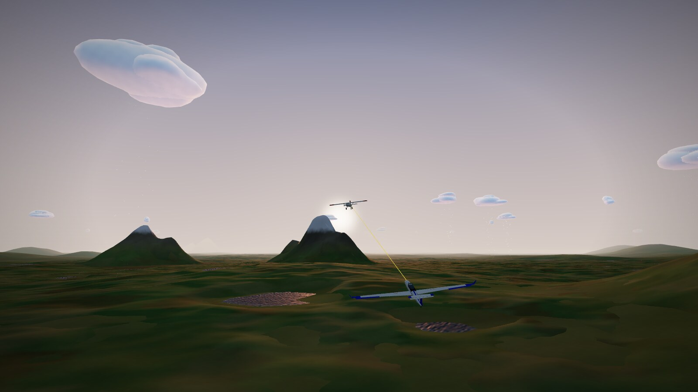
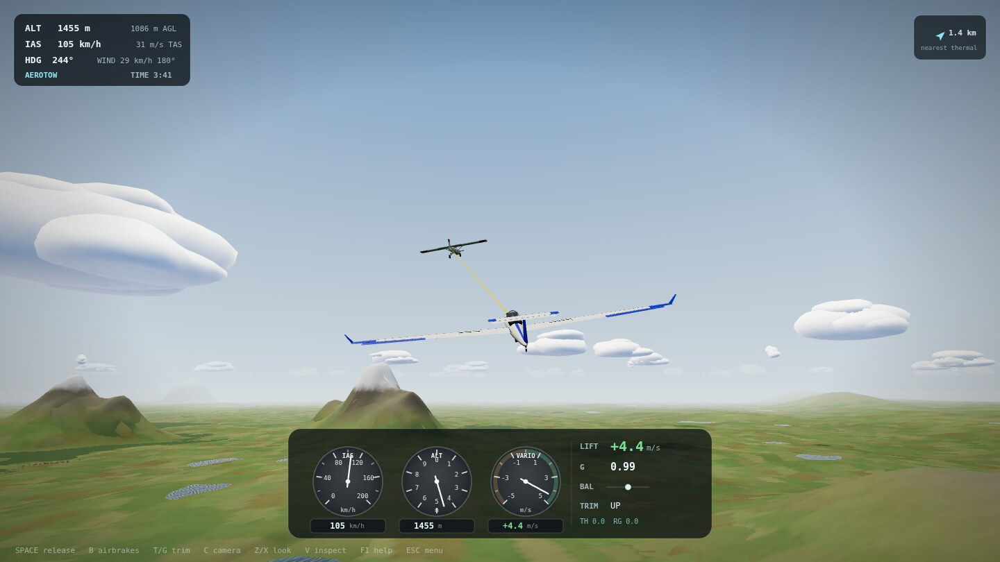
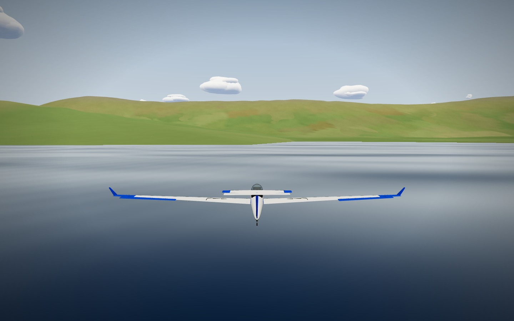
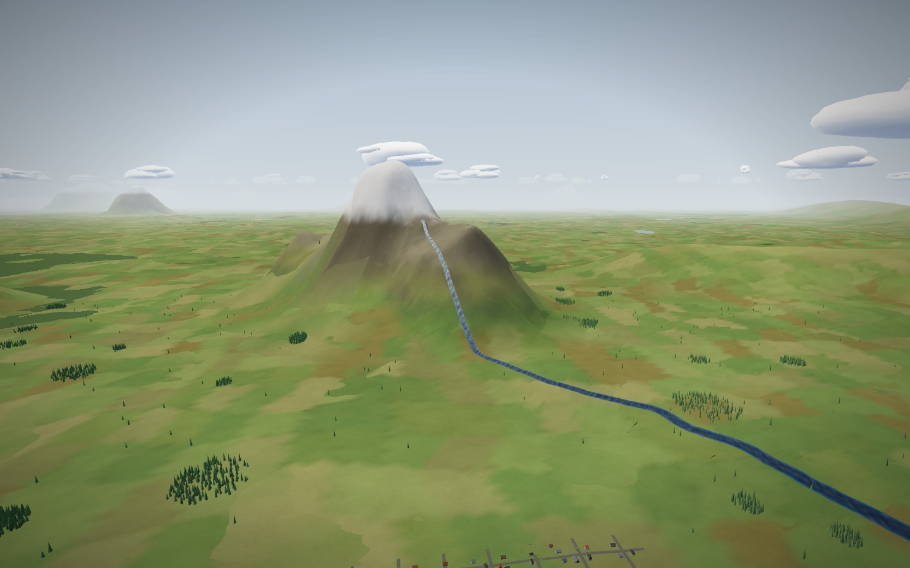
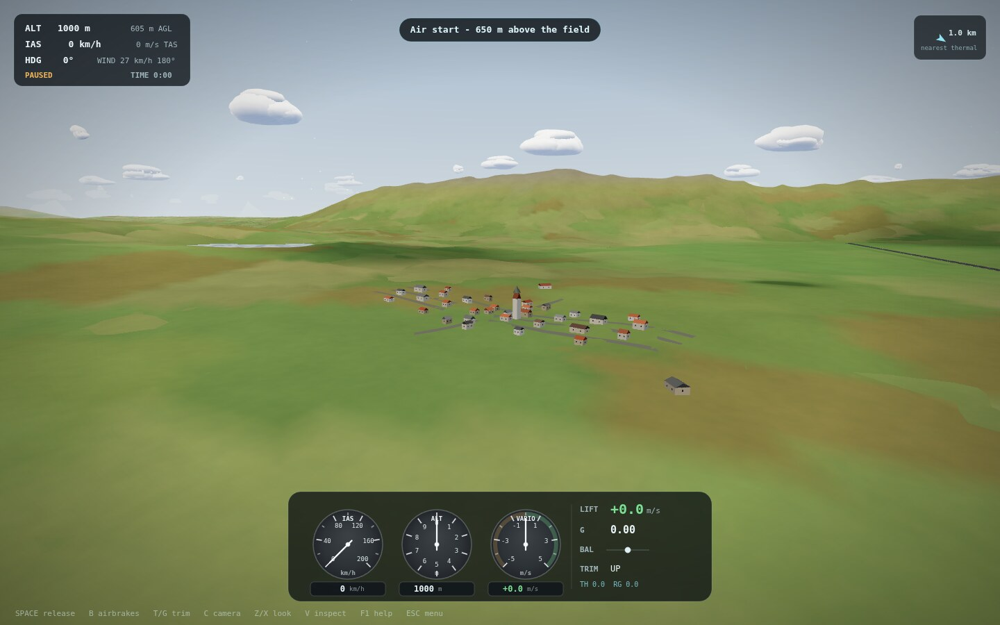

# Gludor

A quiet browser soaring simulator built around a simple idea: read the sky,
find the lift, and stay up as long as the afternoon allows.

Gludor is a solo free-flight sim with a fictional 15 m single-seater, the
**GD-81**. It runs entirely in the browser on Three.js and TypeScript, with a
hand-written 6DOF flight model and seeded procedural weather. There are no
external models or textures, no game engine, and no physics library.



*Golden hour on the wire: the GD-81 follows the tug over farmland, with
snow-capped peaks holding the last light.*

## What is in V1

- **Winch or aerotow launch.** The winch is a constant-power launch with a
  pitch-following assist, an automatic release at 440 m AGL, and a short
  post-release push so the glider does not zoom. The aerotow puts a procedural
  tug on the runway ahead of you; it lifts off, climbs away, and turns gently
  over the field, towing you to 1,200 m AGL.
- **An endless procedural world.** One home airfield at the origin (400 m
  elevation) with a 2 km asphalt runway and a shorter parallel grass strip,
  plus a grass strip beside roughly half the market towns you fly over,
  a chain of finite training ridges north and west of the field, snow-capped
  alpine ranges
  beyond 6 km, rolling farmland, clustered woodland, lakes scattered across the
  farmland, market towns strung along their lanes, and cumulus clouds marking
  the thermals. Terrain, trees, water, buildings, clouds, and shadows all stream
  around the glider, so there is no visible boundary however far you fly.
- **Light that connects sky and ground.** Soft cloud shadows drift across the
  terrain, with fields, meadows, and forest copses breaking up the low-poly
  ground.
- **Weather that matters.** Logarithmic wind shear, veer with height, seeded
  gusty turbulence, thermal cores that widen with altitude, compensating sink
  between them, and ridge lift on the windward slope.
- **A real-ish glider.** 450 kg, 11 m² wing, 15 m span, CD0 0.010, Oswald 0.9,
  CLmax 1.6. It glides at roughly 102 km/h IAS with an L/D of about 37.5 and
  stalls near 73 km/h. The visual model is a smooth composite single-seater:
  lofted airfoil wings with winglets, a T-tail, a main wheel half sunk into the
  belly, a tiny tailwheel caster, a cobalt-and-pearl livery with a GD-81 fin
  decal, and a wing that flexes with G-load.
- **Instruments.** IAS, altitude, total-energy vario, slip ball, G-load, trim,
  and a compact flight computer with the nearest thermal distance and bearing;
  inside a core it switches to a centering cue that turns green when you are
  centred. A second cue below it lists the two nearest named strips with their
  bearings, designators and lengths, so there is always a landing option in
  sight. The 3D
  cockpit panel carries live needles and digital readouts too.
- **Views.** Chase, cockpit (canopy frame, arched dash, knee wells and live
  panel), and orbit. Mouse-drag looks around; double-click resets. A detached
  free camera (`V`) lets you inspect the terrain from the menu or mid-flight.
- **Full flight loop.** Pause, restart, crash/ditching detection, a steerable
  landing roll with wheel brakes, a post-flight summary, procedural
  wind/vario/stall audio, an optional ambient score, and a debug telemetry
  overlay.

V1 is deliberately solo: no tasks, scoring, multiplayer, wave, real DEM data,
VR, or mobile touch controls.

## Aerotow



Choose **Aerotow · 1,200 m** on the menu and a small high-wing tug is waiting
at the far end of the rope. Aerotow is flown from the home field only; the
streamed town strips launch by winch or air start. It accelerates down the runway first, lifts off at
27 m/s, and settles into a gentle left-hand climbing turn once it is 150 m above
the field. The turn is wide — a 620 m radius — so the tow is a slow scenic
spiral over the airfield rather than a steep departure.

The 60 m rope is a spring-damper, not a rigid link: it stays slack until the
tug draws it taut, pulls through a virtual nose hook, and can never stretch
beyond two metres. With flight assist on, the glider follows the tug's wake and
the rope line automatically; the stick always overrides it, and `F2` turns the
assist off entirely. Release with Space at any time, or let the tow release
itself at 1,200 m AGL. The tug flies on for a few seconds after the release
before it leaves the scene.

## Lakes, rivers and landmarks

Lakes come and go as you fly: deep blue water in a carved basin, a lighter
shelving shoreline, and wind-stretched ripples that catch the light. They are
landmarks rather than obstacles. Water starts no thermals and grows no trees,
and arriving on one is a forgiving ditching instead of a crash — wet, slow, and
a long tow home.



### Rivers

Two hand-placed streams run through the home valley. The western river rises on
the snow line of the ice-capped mountain west of the field and runs all the way
down into the lake in the western valley, widening from roughly 30 m to 125 m
on the way and entering through a small estuary. The eastern stream runs west across
the open ground south of the airfield into a low meadow, widening from about
20 m to 50 m. The width changes along every course, and the water carries a
travelling flow wave, so the ribbons do not look static.

The channels are carved into the terrain and count as water for ditching. Town
sites keep clear of the stream corridors, so roads do not cross water until
bridges become worthwhile.



## Mountains

The training ridges are deliberately finite and hand-placed. North of the
airfield a 15 km central bank runs east-west, with a shorter spur and a real
col beyond each end, so a ridge run is a route from one climb to the next
rather than a lap of one wall. A north-south bank stands west of the field,
crossing the west spur in a high junction; it barely works in the usual
southerly, but gives westerly days a long slope of their own.

Beyond 6 km the world grows a seeded 9 km mountain grid. Each cell owns a
massif or nothing, and the massif comes entirely from its cell seed: usually a
broad, rounded hill, sometimes a narrower alpine peak with a steep spire and a
short arete of satellite summits. Contributions fade in between 6 km and
7.5 km, so the field, home town, and home thermal keep their flat bowl, and
combined heights ease into a cap rather than ending in a flat mesa.

The highest peaks cross the snow line. Snow is shaded per fragment in the
terrain material, so caps stay smooth at every LOD and break into ragged edges
instead of following the vertex grid. Everything is the same analytic surface
that physics and ridge lift use, and that lakes and towns are placed against,
so a windward alpine slope works as well as the home ridge.


## Towns

Towns appear on the same seeded pattern as everything else: a 6 km hash grid
decides where one stands, and each is laid out from its own cell seed, so a
town is identical every time you fly over it. Apart from the home town, the
nearest is about 6 km from the field, and around half a dozen sit within a
normal 18 km glide.

A fixed home town stands 2.4 km southwest of the airfield, on flat, dry ground
clear of the approach, so there is always a landmark in sight from the field.
It is one of the larger settlements — around 400 buildings — and always gets a
church tower. The rest obey a 3 km keep-out around the field and never crowd the
home town.

Most towns are a proper size now: the footprint covers four times its old area
and the streets form a dense square grid rather than one long cross. Nine lanes
run in each direction, making an 8 × 8 pattern of blocks with rows of cottages
and barns along every street and a handful of three- and four-storey tenements.
The largest settlements run past 400 buildings, while the smallest still have
about 185. Houses are deliberately oversized — twice life-size — so they read
from soaring altitude; their plots, streets and spacing scale with them. Roofs
are solid, so a low arrival over a town ends the flight — pick a clear field
instead of a garden.



## Town airfields

About half the towns own a grass strip, and the menu lists home plus the
nearest dozen within 30 km, named after their town and labelled by runway
designator, length and distance.
Pick one and launch by winch or air start; the runway end is chosen into the
wind, so the winch is always ahead of you.

Strips stream like everything else and are deterministic per town cell. Each
one carries its town's fictional name; the home strip is Brackenmoor. The same
name appears in the departure picker and the landing cue. A site is only used
when the ground is dry, clear of the rivers and the town, and flat enough to
grade. The runway follows the natural long profile of its hillside
but is levelled across its width, with a short blend back into the meadow, so
the earthworks stay small. Threshold bars, a windsock and a small shed mark the
field, and one dependable thermal sits a short glide away so a country launch
is not followed by a long search for lift. The finest terrain tier is cut away
under each pad and replaced with a high-resolution surface, so the 50 m ground
mesh cannot bridge the strip and poke through the runway.

## Quick start

Requires Node.js 20.19+ (or 22.12+) and a WebGL2-capable desktop browser.

```bash
npm install
npm run dev
```

Open the printed URL (normally <http://localhost:5173>), pick a weather preset,
a departure field and a launch, then press **Fly**.

```bash
npm test        # 81 headless flight/aero/weather/streaming/lake/river/town/airfield/mountain/tow tests
npm run typecheck
npm run build   # static production build in dist/
npm run preview # serve the production build locally
```

## Controls

| Input | Action |
| --- | --- |
| `W` / `S` or `↑` / `↓` | Pitch — forward pushes, back pulls |
| `A` / `D` or `←` / `→` | Roll |
| `Q` / `E` | Rudder |
| `B` | Airbrakes (hold); wheel brake during the landing roll |
| `T` / `G` | Trim nose up / nose down |
| `Space` | Release the winch cable or tow rope |
| `C` | Cycle chase / cockpit / orbit view |
| `Z` / `X` | Toggle looking left / right in cockpit view |
| `V` | Toggle the free inspection camera |
| Mouse drag | Look around in cockpit, orbit, and free camera |
| `W` `A` `S` `D` | Move in the free camera |
| `Q` / `E` | Free camera down / up |
| `Shift` | Free camera boost |
| Double-click | Reset the view |
| `R` | Restart the flight |
| `Esc` | Pause, or close the help panel |
| `F1` or `H` | Controls and soaring tips |
| `F2` | Toggle flight assist (auto-rudder; on by default) |
| `F3` | Debug telemetry overlay |
| `F4` | Thermal helpers (particles and core cue) |
| `M` | Ambient music on / off (off by default) |
| `Shift` + `S` | Sound effects on / off (music unaffected) |

On the menu, **Enter** starts the selected flight.

## Flying notes

1. **Launch.** On the winch, hold the cable and let it pull. The glider rotates
   and climbs at roughly 11–17 m/s. On the aerotow, the tug rolls first: let the
   rope come taut, follow it off the runway, and the assist keeps you in its
   wake through the climbing turn. Space releases either launch early; the winch
   releases automatically at 440 m AGL and the tow at 1,200 m AGL.
2. **Center a thermal.** Cumulus sit above the cores. Bank 40–50°, keep the
   slip ball centered, and watch the total-energy vario. Thermals are strongest
   in the middle and widen with height. The top-right helper points at the
   nearest core; inside it switches to metres and turns green with a `CORE`
   label when you are centered.
3. **Use the ridge.** With a southerly wind, the long central bank north of the
   field produces smooth mechanical lift; work it from spur to spur and cross
   the cols with height. On a westerly, the north-south bank to the west takes
   over. Stay inside the band just above the windward face.
4. **Land.** Airbrakes are effective. Arrive with height, fly a normal circuit,
   and touch down wings level and slow. Below 20 m above the ground the HUD
   shows a small flare strip with height, sink and a marker over the green
   1.2–6 m band, so you can judge the hold-off even when the nose hides the
   near runway. The top-right field cue keeps the two nearest strips' bearings,
   designators and lengths in view if the lift dies on you. Ground contact above
   3.4 m/s vertical speed, more than ~30° of bank, or a nose-down attitude is treated as a
   crash. A safe touchdown starts a real landing roll: the glider keeps moving,
   `Q`/`E` steer with the rudder, and `B` applies the wheel brake. The summary
   opens once it comes to rest. A touchdown on a lake is always a ditching,
   however fast: the flight ends gently and the summary says so. A town roof is
   solid, so pick an open field rather than a garden.

### Cockpit view


`C` cycles chase → cockpit → orbit. The canopy is a compact bubble whose sill
stays flush on the fuselage; from the pilot's seat it is a thin reflective inner
shell with a front bow and glinting edges, so you are aware of the glass without
it fogging the view. The side rails, centre stick and centre
console stay in sight, with the nose below the panel giving the horizon
reference; mouse-drag looks around, and `Z` / `X` toggle a shoulder check to the
left or right. The panel sits low under the coaming, the canopy clears the eye,
and the nose line falls away ahead of it, so the aiming point stays in view
as the nose comes up; below 20 m a compact flare strip shows height and sink in
the bottom corner.
The dash is a moulded arch that sweeps down into deep knee cut-outs either side
of the centre tunnel, and the flocked deck carries two dark footwells with baked
contact shadows, so the cockpit reads as a shaded tub rather than a flat plate.
The centre stick rises from its rubber boot on the tunnel, with the grip just
below the panel. The panel is live: airspeed, a 1,000 m-wrapping altimeter needle
with a digital MSL readout, and a total-energy vario banded green for lift and
amber for sink. The duplicate bottom HUD cluster is hidden in this view so it
never covers the panel.

### Free camera

`V` detaches the view from the glider so you can walk the landscape without
flying. It works from the menu, mid-flight, while paused, and on the summary
screen. Use `W` `A` `S` `D` to move, `Q` / `E` to drop and rise, hold `Shift`
for a fast pass, and drag the mouse to look; double-click levels the view. The
camera never dips below the ground, water, or a roof.

The simulation and audio freeze while you inspect, and the detachable view keeps
the sun's shadow bake centred on the camera, so distant towns and ridges stay
lit correctly. `V` or `Esc` returns to the previous screen and flight state.

## Weather presets

| Preset | Wind | Thermals | Character |
| --- | --- | --- | --- |
| Gentle afternoon | 5 km/h | 1.1 m/s | Soft air, easy first flight |
| Standard soaring day | 15 km/h | 2.6 m/s | Reliable cumulus and a workable breeze |
| Strong thermals | 22 km/h | 4.2 m/s | Big climbs, strong sink, turbulent boundary layer |
| Ridge day south | 38 km/h | 0.7 m/s | Strong southerly onto the main chain |
| Ridge day west | 38 km/h | 0.7 m/s | Strong westerly onto the north-south bank |
| Evening glass | 8 km/h | 0.5 m/s | Smooth air, weak lift, long shadows |

Wind direction, speed, thermal strength, turbulence, cloudbase, and time of day
are also exposed as sliders before launch.

## How it works

### Simulation

The physics loop runs at a fixed **240 Hz**, decoupled from rendering with an
accumulator. The glider is a rigid body with a quaternion attitude and body
angular rates.

Forces are computed in the body frame and rotated into world space:

- Lift and drag from `CL(α)` and `CD(CL)`; stall blends the lift curve past
  `α_stall` and adds separation drag.
- Side force, roll, pitch, and yaw moments from angle of attack, sideslip, and
  the control surfaces.
- A simple inertial model (`Ixx`, `Iyy`, `Izz`) with rate damping.
- Weight is applied once, in `step()`, not again during integration.

Airspeed is wind-relative. IAS comes from the ISA density ratio, and the
total-energy vario adds a clamped acceleration term
(`v_y + (TAS/g)·dV/dt`) so it reads the energy traded in a pull-up or pushover.
The smoothed vario and TE vario both feed the HUD and the variometer audio: fast
high beeps in lift, and a continuous low tone in sink.

Two tuning notes worth knowing if you change the model:

- `cmQ` is much larger than a textbook value (`-140`). The tail is not modelled
  as a separate lifting surface, so this stands in for the missing tail volume;
  without it the phugoid diverges.
- Gravity belongs in exactly one place. Applying it in both `step()` and
  `integrate()` produces a nosedive and runaway airspeed.

### World and weather

The ground is a stateless analytic surface sampled on a world-aligned 50 m
grid, so physics and rendering can evaluate it anywhere. The renderer keeps a
moving window of 4 km tiles at 50 m (near), 8 km at 100 m (mid), and 16 km at
400 m (far); coarse tiers sit slightly below the finer ones and extend
underneath them, hiding both LOD seams and the frames while new edge tiles are
generated. Generation is seeded, so the same world position always produces the
same terrain, whatever order tiles are visited in. The airfield is flattened
around the origin, with a 2 km asphalt runway along Z, a 1.2 km parallel grass
strip, painted runway designators and dashed white grass edges.

Mountains come from a deterministic 9 km grid: each cell has a 60% chance of a
massif, made from one main peak plus up to three satellite summits. Alpine
peaks are narrower and taller than the ordinary rounded hills, and their snow
caps are shaded per fragment in the terrain material so the snow line stays
smooth at every LOD. A continuous mask fades mountain contributions to zero
inside 6 km of the airfield and back to full strength by 7.5 km, and the
combined height eases into a soft cap.

Lakes are generated from a deterministic 2.5 km hash grid, which puts several
inside a short glide of the airfield. A candidate survives only if its basin is
low and gentle enough, its water level is set below the sampled shoreline so the
flat surface cannot spill down a hillside, and it does not overlap a neighbour's
basin (two water planes cannot share one shore). The carve is applied inside the
analytic ground function, which keeps physics, terrain tiles, tree placement, and
the water mesh in agreement. A 1.3 km keep-out protects the runway and the home
thermal. All visible lakes are merged into one water mesh and one draw call; the
shader adds an opaque deep-blue body, a shallow rim, and animated ripple normals.

Rivers use the same water shader, but the coarse terrain tiles cannot resolve
their channels. The terrain streamer cuts the stream corridors out of every LOD,
and a high-resolution bank mesh fills the cut with samples clustered on the
water and banks, so a sloping bank triangle cannot bridge over the ribbon. A
separate river query feeds the water mesh, the carve, ditching, and town
keep-outs from one shared station list.

Woodland streams in deterministic 1 km cells within 10 km of the glider, and
copse placement is derived from a per-cell hash, so the same wood always grows
in the same place. Each cell rolls for a main stand and often a smaller copse,
both tightly packed, so the woods read as dense canopy rather than scattered
dots. Field patchwork stays baked into the terrain vertex colours, and the
instanced tree meshes keep the farmland readable from the air without extra
draw calls. Trees avoid open water and town footprints.

Towns use a deterministic 6 km grid with a 3 km keep-out around the airfield,
plus one fixed home town in the southwest that is exempt from the keep-out
and always gets a church tower. Town airfields are planned from the same grid:
each cell's strip is a pure function of its seed, so a runway is identical
however the world is streamed. Only about half the towns qualify, and a strip
is rejected for water, a river corridor, a crowded neighbour, or ground that
would need more than a few metres of cut and fill. A candidate is rejected if its centre or rim is
too high, too steep, or lapped by a lake; neighbours that would overlap keep the
lower-indexed cell, so the result never depends on query order. The placement and
building data are pure simulation code, shared by the physics and the renderer,
so what you see is exactly what you can hit. All walls, roofs, spires, and
windows in range are instanced (four draw calls), and the streets are one merged
ribbon that follows the ground. Buildings extend two metres below their plot to
hide slopes rather than flattening the terrain.

Thermals come from a deterministic 2.5 km hash grid that is rebuilt around the
glider every 2 km; the dependable home thermal at (620, −720) is always present
near the field, and each town strip owns a guaranteed thermal a short glide
away. Lake surfaces cool the boundary layer, so their cells start no
thermals. Cores are deliberately wide — roughly 1.6–3 km across at their base,
depending on the day — and flat-topped rather than sharply peaked, widen with
height, and stay fixed under their cloud markers so the sky you aim at is the
air you get. The marker cloud keeps a tighter footprint over the strong core,
so the lift fades out well beyond the visible cumulus instead of stopping at
its edge. The field also includes compensating sink and ridge lift computed
from the terrain gradient and wind. Wind uses a logarithmic boundary-layer
profile, a few degrees of veer per kilometre, and seeded multi-frequency gusts
whose amplitude scales with speed and the turbulence setting.

Clouds stream as 16 km tiles in a 5 × 5 window, with a couple of background
cumulus per tile plus one marker cloud above each thermal. A rolling 32 km
shadow bake follows the glider and re-projects the loaded cloud footprints along
the sun direction, so ground shadows stay aligned with the visible sky.

### Rendering and UI

Three.js draws a stylized low-poly scene: smooth-shaded, vertex-colored terrain
chunks, opaque lake and river surfaces, clustered towns, a procedural sky, soft
cumulus clouds, baked cloud shadows, the GD-81 mesh, the winch/tow cable, the
procedural aerotow tug and its spinning propeller, and thermal particles. The
HUD is a separate 2D canvas with vector-drawn instruments. Audio is synthesized with
WebAudio: filtered wind noise scaled by IAS, vario lift beeps and a low sink
tone, a stall horn, a landing thump, and a filtered engine drone while the tug
is on the rope. An optional generative score (`M`) picks a new key and tempo
for each flight and plays an A A' B A' form: a breathing five-voice pad, a
pentatonic melody and chord-tone bells locked to a swung eighth-note grid, over
a soft brushed downtempo pulse; it is off by default.

## Project layout

```text
src/
  config.ts          GD-81 coefficients, weather presets, world constants
  main.ts            app state, fixed-step loop, input/UI/audio wiring
  core/              small math and seeded RNG helpers
  sim/
    terrain.ts       analytic ground, mountains, lake and river carving, airfield flattening
    towns.ts         deterministic towns, footprints, roof queries
    airfields.ts     deterministic town strips, runway profiles, grading, field picker
    atmosphere.ts    ISA density, wind shear, veer, turbulence
    lift.ts          thermal, ridge, and sink field
    aero.ts          lift/drag/moment coefficients
    towplane.ts      scripted aerotow tug: roll, climb, turn, release, departure
    simulation.ts    6DOF flight loop, winch and aerotow rope, ground/water/roof
                     contact, landing rollout, telemetry
  render/            Three.js scene, terrain/water/river-bank/town/airfield/glider/cloud/sky
                     meshes, and the procedural aerotow tug
  ui/                HUD instruments and menu/pause/summary wiring
  input/             keyboard state
  audio/             procedural WebAudio soundscape
test/                aero, flight, weather, streaming, lake, river, town, airfield,
                     mountain, aerotow, and landing-rollout tests
```

## Tests

The headless suite exercises the model rather than the DOM:

- Aerodynamics: lift curve, drag polar, symmetry, stall behavior.
- Flight: trimmed glide in still air (102 km/h, L/D ≈ 37.5, sink ≈ 0.75 m/s),
  roll rate, stall and recovery, winch launch profile, and ridge lift.
- Weather: a differential test that drops the same glider through a thermal
  core and through still air, then compares the height lost.
- Thermals: the differential lift test, a broad flat-topped core profile, fixed
  columns under their cloud markers, and the HUD's inside/core contract.
- Streaming: far-field terrain sampling, bilinear grid consistency, thermal
  grid determinism across rebuilds, home-thermal retention, and lift far from
  the field.
- Lakes: deterministic generation, airfield exclusion, sensible landmark
  density, shoreline containment, water-aware thermals, and ditching rather
  than crashing.
- Rivers: deterministic hand-placed courses, terrain-following profiles with an
  overall descent, carved beds, water-level queries, town clearance, and
  ditching on a stream.
- Landings: touchdown enters a rollout rather than ending immediately, wheel
  braking shortens the roll, rudder steering turns it, it cannot bounce back
  into the air, air time freezes at touchdown, and it settles into the landed
  state.
- Towns: deterministic layout, airfield exclusion, the fixed home town and its
  tower, dry workable plots, roof queries, believable density, and a fatal roof
  strike.
- Airfields: deterministic streaming, sane counts and lengths, dry graded
  profiles, home-plus-nearest ordering, inside-the-pad queries, wind-chosen
  runway ends, satellite winch and air starts, home-only aerotow, and a
  guaranteed thermal at every strip.
- Mountains: determinism, the six-kilometre keep-out, finite hand-placed ridges,
  alpine peaks alongside ordinary foothills, plausible height bounds, and
  snow-line summits.
- Aerotow: runway setup and rope length, a hands-off climb to 1,200 m in a
  controlled turn, stability in the standard breeze, manual release and tug
  departure, and determinism.

```bash
npm test
```

Expected: **63 passing tests**.

## Deployment

`npm run build` emits a self-contained static site in `dist/`. Serve that
directory from any static host (GitHub Pages, Netlify, Cloudflare Pages, S3, or
`npm run preview`).

If the site is hosted under a subpath, set Vite's base path at build time:

```bash
npm run build -- --base=/gludor/
```

## Known limitations

- The flight model is "study-lite": plausible handling and energy behavior, not
  a validated engineering simulation.
- The world is procedural and stylized, not real terrain.
- Lakes are flat surfaces; rivers follow a sloping profile. At far distances the
  400 m terrain tier only approximates small basins, so a distant lake or river
  can look simpler than it does up close.
- Towns sit on the existing ground instead of flattening it. Walls are sunk
  into the plot to hide slopes, but a very steep site can still show a small
  step at a building's uphill edge.
- Weather is procedural and seeded: the same seed and settings always produce
  the same terrain, thermals, and gust sequence. There is no live forecast or
  dynamic task setting.
- Desktop keyboard and mouse are the supported inputs. Mobile touch is out of
  scope for V1.
- The single JavaScript bundle is about 643 kB (roughly 173 kB gzipped),
  mostly Three.js.
