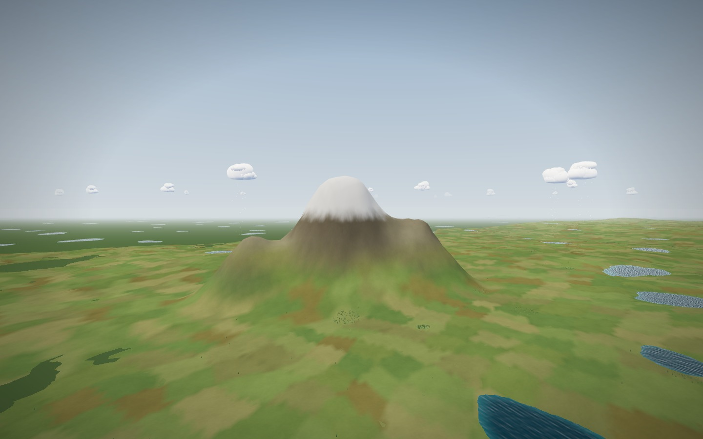
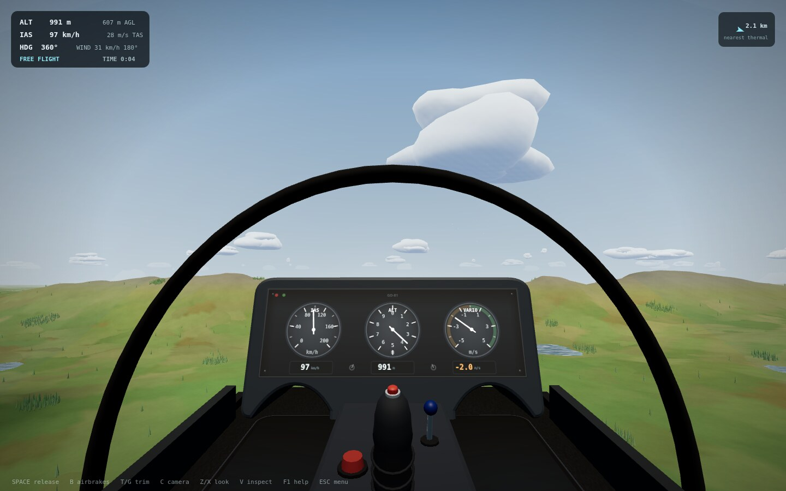

# Gludor

A quiet browser soaring simulator built around a simple idea: read the sky,
find the lift, and stay up as long as the afternoon allows.

Gludor is a solo free-flight sim with a fictional 15 m single-seater, the
**GD-81**. It runs in the browser and asks only for a keyboard, a little
patience, and an eye for the next cumulus. There are no tasks, no score, and no
traffic — just weather, terrain, and the next climb.


*Golden hour on the wire.*

## What you can do

- **Launch three ways.** Winch, aerotow, or air start. Aerotow stays at the
  home field; town strips launch by winch or air start.
- **Fly an endless countryside.** Farmland, woodland, lakes, rivers, market
  towns, training ridges, and snow-capped alpine peaks, all streaming around
  you.
- **Soar the sky.** Wide thermals under cumulus, ridge lift on the windward
  faces, and the sink in between. Six weather presets, from a gentle afternoon
  to a strong ridge day.
- **Land almost anywhere.** Home has the long asphalt runway; about half the
  towns own a named grass strip. The departure picker lists home and the
  nearest strips, and the HUD points at the two closest runways with distance,
  bearing, designator, and length.
- **Fly your way.** Chase, cockpit, orbit, and a free inspection camera; a full
  landing roll with wheel brakes, a post-flight summary, and procedural wind,
  vario, stall, and ambient audio.
- **Read the sky.** The flight computer shows the nearest thermal, with a
  centering cue inside a core, and the two nearest fields, so there is always a
  landing option in sight.

## Quick start

Requires Node.js 20.19+ (or 22.12+) and a WebGL2-capable desktop browser.

```bash
npm install
npm run dev
```

Open the printed URL (normally <http://localhost:5173>), pick a weather preset,
a departure field, and a launch, then press **Fly**. On the menu, **Enter**
starts the selected flight.

## Controls

| Input | Action |
| --- | --- |
| `W` / `S` or `↑` / `↓` | Pitch — forward pushes, back pulls |
| `A` / `D` or `←` / `→` | Roll |
| `Q` / `E` | Rudder |
| `B` | Airbrakes (hold); wheel brake during the landing roll |
| `T` / `G` | Trim nose up / nose down |
| `Space` | Release the winch cable or tow rope |
| `C` | Cycle chase / cockpit / orbit view |
| `Z` / `X` | Toggle looking left / right in cockpit view |
| `V` | Toggle the free inspection camera |
| Mouse drag | Look around in cockpit, orbit, and free camera |
| `W` `A` `S` `D` | Move in the free camera |
| `Q` / `E` | Free camera down / up |
| `Shift` | Free camera boost |
| Double-click | Reset the view |
| `R` | Restart the flight |
| `Esc` | Pause, or close the help panel |
| `F1` or `H` | Controls and soaring tips |
| `F2` | Toggle flight assist (auto-rudder; on by default) |
| `F3` | Debug telemetry overlay |
| `F4` | Thermal helpers (particles and core cue) |
| `M` | Ambient music on / off (off by default) |
| `Shift` + `S` | Sound effects on / off (music unaffected) |

## Your first flight

1. **Launch.** On the winch, hold on and let it pull; the glider rotates and
   climbs at roughly 11–17 m/s. On aerotow, let the rope come taut and follow
   the tug through its gentle climbing turn. `Space` releases either launch
   early; the winch releases automatically at 440 m AGL and the tow at 1,200 m.
2. **Find lift.** Cumulus sit above the cores. Bank 40–50°, keep the slip ball
   centered, and watch the total-energy vario. The top-right thermal cue points
   at the nearest core and turns green with a `CORE` label when you are
   centered.
3. **Use the ridge.** A southerly wind works the long central bank north of the
   field; a westerly works the north–south bank to the west. Stay just above
   the windward face and work it from spur to spur.
4. **Land.** Airbrakes are effective. Arrive with height, fly a normal circuit,
   and touch down wings level and slow. Below 20 m the HUD shows a flare strip
   with height and sink, so you can judge the hold-off even when the nose hides
   the runway. The top-right field cue keeps the two nearest strips in view.
   Use `Q`/`E` to steer the roll and `B` for the wheel brake. A roof is solid;
   a lake is a soft ditching; the summary opens when you come to rest.

## The world

The home field sits in a flat bowl at about 400 m, with a 2 km asphalt runway,
a shorter parallel grass strip, and the market town of **Brackenmoor** a short
glide to the southwest. North and west, a handful of finite training ridges
give the first thermals and ridge runs somewhere to begin.

Beyond the home valley the world keeps going: rolling farmland, dense
woodland, lakes and streams, market towns, and a seeded range of rounded hills
and alpine peaks with snow on the highest tops. Everything streams around the
glider, so there is no edge to reach.

About half the towns also own a grass strip, named after the town — `Ashwick ·
09/27 · 539 m`, for example. The departure picker lists home and the nearest
strips within 30 km; pick one and launch by winch or air start. Each strip has
a dependable thermal a short glide away, and the ground is graded to a clean,
level runway with threshold bars, a windsock, and a small shed.


*A market town spread across the farmland.*



*The higher ground, with snow on the summit.*

## Views

`C` cycles **chase**, **cockpit**, and **orbit**. Mouse-drag looks around and
double-click resets. In the cockpit the canopy, side rails, centre stick, and
live instrument panel stay in view; `Z`/`X` check over each shoulder. Below
20 m a compact flare strip shows height and sink.

`V` detaches a free inspection camera. Use `W` `A` `S` `D` to move, `Q`/`E` to
drop and rise, hold `Shift` for a fast pass, and drag to look. The flight and
audio freeze while you inspect; `V` or `Esc` returns.



*The view from the cockpit.*

## Weather presets

| Preset | Wind | Thermals | Character |
| --- | --- | --- | --- |
| Gentle afternoon | 5 km/h | 1.1 m/s | Soft air, easy first flight |
| Standard soaring day | 15 km/h | 2.6 m/s | Reliable cumulus and a workable breeze |
| Strong thermals | 22 km/h | 4.2 m/s | Big climbs, strong sink, turbulent boundary layer |
| Ridge day south | 38 km/h | 0.7 m/s | Strong southerly onto the main chain |
| Ridge day west | 38 km/h | 0.7 m/s | Strong westerly onto the north-south bank |
| Evening glass | 8 km/h | 0.5 m/s | Smooth air, weak lift, long shadows |

Wind direction, speed, thermal strength, turbulence, cloudbase, and time of day
are also exposed as sliders before launch.

## Known limitations

- The flight model is plausible and forgiving, not a validated engineering
  simulation.
- The world is procedural and stylized, not real terrain.
- Distant lakes, rivers, and town sites can look simpler than they do up close.
- Desktop keyboard and mouse are the supported inputs; mobile touch is out of
  scope.
- V1 is solo: no tasks, scoring, multiplayer, wave, VR, or live weather.
- The same seed and settings always produce the same world, thermals, and
  gusts.

## For developers

Implementation notes, project layout, test details, and deployment live in
[docs/DEVELOPING.md](docs/DEVELOPING.md).

```bash
npm test        # 81 headless tests
npm run typecheck
npm run build
```
